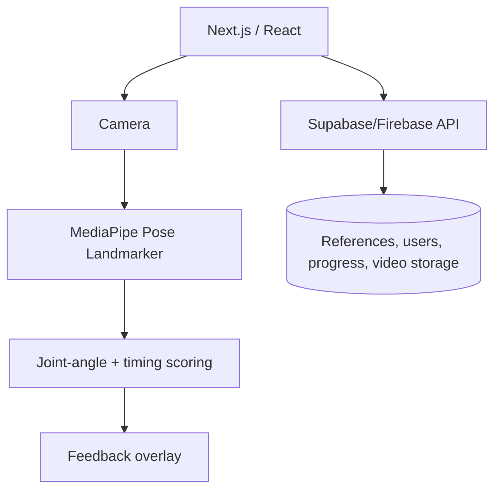

# Sanggar Digital

Gerak Tradisi, Hidup Kembali.

Sanggar Digital is a hackathon concept for digitally regenerating Indonesian traditional dance. Dancers and sanggars can contribute movement references, while learners practice through a camera and receive real-time pose feedback.

## Why this exists

Traditional dance knowledge is often concentrated in sanggars and senior dancers. Ordinary video documentation preserves footage, but does not give learners interactive feedback. Sanggar Digital connects cultural knowledge holders with a digital learning experience without reducing the tradition to generic dance scoring.

## MVP

1. Real-time AI Coach
   - Select a dance or movement.
   - Practice through the camera.
   - Track pose on-device with MediaPipe Pose Landmarker.
   - Compare key joint angles and timing against a reference.
   - Show score, overlay, and specific feedback.

2. Crowdsource Reference
   - Dancers, sanggars, or advanced users upload movement videos.
   - Store pose data and cultural metadata.
   - Apply a basic quality gate, attribution, upvote, and flag flow.

3. Collaborative Practice (post-MVP)
   - Prefer asynchronous challenges or invite-only duets before live stranger matching.
   - The product goal is learning together, not building an unmoderated social video app.

## Hackathon scope

Start with one or two dances or movement sequences. A small, high-quality reference set is more valuable than a large library with unreliable scoring.

## Architecture

Full diagrams are in `diagrams/`.

## Repository layout

- `docs/` — PDF and editable proposal
- `diagrams/` — Mermaid source and rendered PNG diagrams
- `brand/` — brand direction and editable logo concept

## Brand direction

Recommended name: Sanggar Digital  
Tagline: Gerak Tradisi, Hidup Kembali.

The logo in `brand/logo-concept.svg` is an early concept: a flowing human figure with joint-like accents. It is not a final cultural identity and should be reviewed with dancers or sanggar partners before public use.

## Important product constraints

- Get permission and attribution for contributed videos and movement references.
- Do not claim that a simple pose score represents absolute technical or cultural correctness.
- Keep cultural context attached to the movement reference.
- Prioritize a reliable demo over feature count.
- Treat moderation and user safety as requirements for any social/duet feature.

## Status

Concept and hackathon proposal package. Product implementation is not included in this repository yet.

## License

The source files in this repository are released under the MIT License. See [LICENSE](LICENSE).

The license does not remove the need to obtain consent, attribution, or third-party rights for cultural materials, videos, music, datasets, logos, or contributed content. Those materials may have separate terms.
